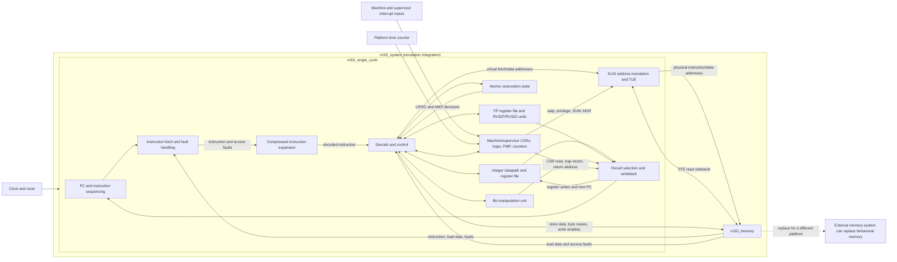

# CPU architecture layout

This document describes the implemented CPU at the RTL boundary. It is a
logical block diagram of the current single-cycle design, not a physical
silicon floorplan. The CPU is `rv32i_single_cycle`; `rv32i_system` connects it
to behavioral memory for simulation and simple demonstrations.

## System-level wiring



## Main blocks and responsibilities

| Block | RTL / location | Responsibility |
| --- | --- | --- |
| Simulation system top | `rv32i_system.sv` | Wires the CPU's instruction, data, and PTE ports to behavioral memory and exposes clock, reset, time, and interrupt inputs. |
| CPU integration | `rv32i_single_cycle.sv` | Connects fetch, decode, execution, translation, CSR/trap control, memory requests, and writeback. Most base integer decode and control currently live in this module. |
| PC and sequencing | `rv32i_single_cycle.sv` | Tracks `program_counter`, handles 2-byte/4-byte instruction increments, branches/jumps, stalls, and trap-vector selection. |
| Instruction expansion | `rv32c_decompressor.sv` | Converts supported 16-bit compressed encodings into 32-bit instruction encodings before normal decode. |
| Integer datapath | `rv32i_single_cycle.sv` | Holds the 32-entry integer register bank (x0 reads as zero), immediate generation, integer ALU operations, address generation, and integer writeback. |
| Bit manipulation | `rv32i_bitmanip.sv` | Implements the supported Zba/Zbb/Zbs/Zicond instruction subset. |
| Floating point | `rv32f_unit.sv`, `rv32d_unit.sv`, and the core | Implements simulation-oriented FP execution and the floating-point register state/writeback. |
| Privileged control | `rv32i_machine_csrs.sv` | Holds machine/supervisor CSR state, privilege, interrupt qualification, trap entry/return, counters, FCSR, and PMP checks. |
| Address translation | `rv32i_sv32_mmu.sv` | Translates eligible virtual instruction/data addresses, walks page tables through the PTE sideband, and maintains the small TLB. |
| Behavioral memory | `rv32i_memory.sv` | Optional simulation memory with separate instruction/data paths, byte write lanes, adjacent-word access, and PTE reads. It is not instantiated inside the CPU core. |
| Display | `rv32i_hex_display.sv` | Optional board/demo peripheral; it is not part of the processor datapath. |

## Memory and address connections

`rv32i_system` connects `rv32i_single_cycle` and `rv32i_memory`. The wrapper
returns instruction/data read data and access-fault signals and forwards the
PTE-read sideband to memory when Sv32 is used. A different SoC can replace
`rv32i_memory` with an external memory subsystem while preserving those ports.

The PC is the virtual fetch address when translation is active.
`rv32i_sv32_mmu` produces physical fetch/data addresses for the memory ports.
The MMU's PTE requests use a third, read-only address/data/fault sideband.
Interrupt pins and `time_counter` are platform inputs; the core does not
instantiate a timer, interrupt controller, firmware, or UEFI environment.

## Single-cycle timing model

The design is single-cycle for instruction execution with combinational
instruction/data reads. Architectural state (PC, integer/floating registers,
CSR state, reservations, and memory stores) changes on clock edges. Sv32 page
table walks can stall instruction progress while the walker performs its
memory-side work; a stall suppresses retirement and side effects.

## System integration view

```text
             +--------------------+
 clock ----->|                    |---- instruction address ----+
 reset ----->|  rv32i_single_cycle |<--- instruction / fault -----|---+
 interrupts->|                    |---- data address / writes ---|   |
 time ------>|                    |<--- data / fault -------------|   |
             |                    |---- PTE read request ---------|   |
             +--------------------+<--- PTE data / fault ---------|   |
                                                                  v   |
                    +---------------------------------------------+---+
                    | rv32i_memory                                    |
                    +-------------------------------------------------+
```

The wrapper is a simulation integration top. A production SoC can replace
`rv32i_memory` with separate instruction/data buses, caches, an interconnect,
and external physical memory while preserving the core's interface contract.
